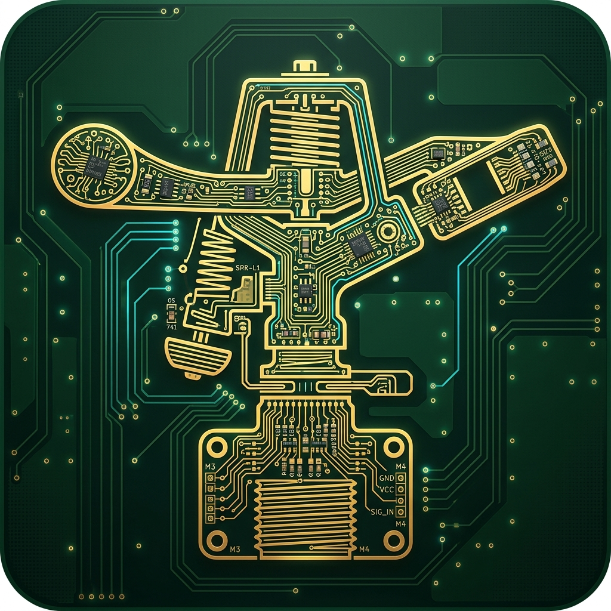

# FanControl.io 🌀

[](https://www.home-assistant.io/)
[](https://opensource.org/licenses/MIT)


> **Intel-spec 25kHz 4-wire PWM cooling fan & thermal orchestration system for Home Assistant with distributed ESP32 edge microcontroller support.**

<p align="center">
  
</p>

---

## ⚡ Overview

**FanControl.io** turns your Home Assistant instance into a precision thermal management and variable speed cooling hub. It links Home Assistant's environmental sensors and automation engine to distributed **ESP32 edge microcontrollers** (over Wi-Fi, Ethernet, and Bluetooth Low Energy) to provide whisper-quiet, adaptive cooling for server racks, AV enclosures, networking cabinets, battery sheds, and greenhouse grow setups.

```
+-----------------------------------------------------------------------------------+
|                           Home Assistant Core / Supervisor                        |
|                                                                                   |
|    +-------------------------------------------------------------------------+    |
|    |                        FanControl.io Add-on                             |    |
|    |  - Delta-T Thermal Engine (Exhaust vs Intake differential cooling)      |    |
|    |  - Curve Optimizer (Silent, Balanced, Performance, Turbo profiles)     |    |
|    |  - Tachometer RPM Telemetry & Stall Alert Monitor                       |    |
|    |  - Ingress Web UI (Port 8724) & ESPHome Blueprint Distributor           |    |
|    +-----------------------------------+-------------------------------------+    |
+----------------------------------------|------------------------------------------+
                                         | (Native HA API / MQTT / WebSockets)
           +-----------------------------+-----------------------------+
           |                                                           |
+----------v-----------------------------+       +---------------------v--------------------+
|  ESP32 Edge Node: Ethernet / PoE       |       |  ESP32 Edge Node: Wi-Fi + BLE Gateway    |
|  (e.g., WT32-ETH01 / Olimex POE)       |       |  (e.g., ESP32-WROOM-32 / ESP32-S3)       |
|                                        |       |                                          |
|  Hardware Features:                    |       |  Hardware Features:                      |
|  - 10/100 Mbps RJ45 Wired Ethernet     |       |  - 2.4 GHz 802.11 b/g/n Wi-Fi            |
|  - Metal rack Faraday immunity         |       |  - Active BLE Tracker (Xiaomi, Inkbird)  |
|  - 4x 25 kHz Hardware LEDC PWM outputs |       |  - 2-4x Hardware PWM fan outputs         |
|  - 4x Tachometer pulse counter inputs  |       |  - 1-Wire DS18B20 temp probe bus         |
|  - Hardware watchdog auto-failsafe     |       |  - Autonomous failsafe watchdog          |
+----------------------------------------+       +------------------------------------------+
```

---

## 🚀 Key Features

- **🌐 Precision 25 kHz Intel PWM Drivers**:
  - Leverages the ESP32's hardware LEDC peripheral to generate true 25 kHz active-high PWM signals conforming to the Intel 4-Wire PWM fan specification.
  - Eliminates acoustic motor whine and coil clicking at lower duty cycles.
- **📊 Tachometer RPM Monitoring & Stall Detection**:
  - Hardware pulse-counter inputs track RPM in real time.
  - Immediate alert notifications if a fan seizes, stalls, or encounters cable obstructions.
- **🌡️ Delta-T Differential Cooling**:
  - Dynamically regulates fan speeds based on temperature differentials ($\Delta T = T_{exhaust} - T_{intake}$) to eliminate heat pockets without unnecessary noise.
- **🛡️ Edge-Level Autonomous Fail-Safes**:
  - ESP32 firmware includes auto-failsafe watchdogs (`delayed_off` / safety floor); if Home Assistant or the network disconnects, fans automatically ramp to 100% safety speed to protect delicate hardware.
- **🖥️ Native Home Assistant Ingress UI (Port 8724)**:
  - Responsive web dashboard embedded directly in the Home Assistant sidebar for curve tuning, RPM monitoring, and manual overrides.

---

## 📦 Installation in Home Assistant

1. In Home Assistant, navigate to **Settings** -> **Add-ons** -> **Add-on Store**.
2. Click the three dots (top right) -> **Repositories**.
3. Add this repository URL:
   ```text
   https://github.com/Paradigm-Paradox/FanControl.io
   ```
4. Find **FanControl-io** and click **Install**.
5. Configure your fan channels and sensors, start the add-on, and open the Web UI!

---

## 📁 Repository Structure

```text
├── fan_control/
│   ├── config.yaml              # Home Assistant add-on configuration & options schema (Port 8724)
│   ├── Dockerfile               # Multi-arch container definition
│   ├── build.yaml               # Multi-architecture builds (aarch64, amd64, armv7)
│   ├── DOCS.md                  # Comprehensive user and installation documentation
│   ├── CHANGELOG.md             # Version history
│   ├── DESIGN.md                # System architecture & hardware specs
│   ├── templates/esphome/       # Ready-to-flash ESPHome YAML templates (Wi-Fi & Ethernet)
│   └── rootfs/app/              # FastAPI backend & Ingress dashboard
├── icon.png                     # Official vintage PCB fan icon
├── repository.yaml              # Add-on repository catalog manifest
└── README.md
```
